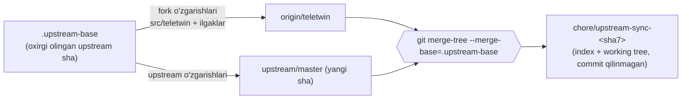

# Upstream (Telegram Web A) yangilanishlarini olish

Fork **orphan import**: birinchi commit `276ffe9` = `Ajaxy/telegram-tt @ 6002824`, umumiy git tarixi yo'q.
Shuning uchun `git merge upstream/master` ishlamaydi (merge-base yo'q). Uning o'rniga upstream asosi
[`.upstream-base`](../.upstream-base) faylida saqlanadi va 3-tomonlama merge shu asos bilan aniq beriladi:



## Tartib

```bash
git remote add upstream https://github.com/Ajaxy/telegram-tt.git   # bir marta
git remote set-url --push upstream no_push

scripts/upstream-sync.sh            # upstream/master ni olib keladi
scripts/upstream-sync.sh <sha>      # aniq upstream commit
scripts/upstream-sync.sh --hooks    # fork o'zgartirgan upstream fayllar: fayl: qator+soni
```

Skript nima qiladi:

1. Toza working tree talab qiladi, `origin/teletwin` va `upstream` ni fetch qiladi.
2. `chore/upstream-sync-<sha7>` branch'ini `origin/teletwin` dan ochadi.
3. `git merge-tree --write-tree --merge-base=<.upstream-base> HEAD <yangi sha>` — haqiqiy 3-tomonlama merge
   (rename aniqlash, konflikt markerlari). Natija index va working tree'ga yoziladi.
4. Forkga tegishli yo'llar doim forkdagidek qoladi: `dist/` (upstream build chiqishi), `tests/` (upstream Playwright,
   bizda gitignore), `.github/` (upstream `package-and-publish.yml` qaytmasin), `package-lock.json` (keyin `npm install`).
5. Fork ataylab o'chirgan upstream fayllar o'chiqligicha qoladi.
6. `.upstream-base` ni yangi sha'ga yangilaydi. Chiqish kodi: `0` — toza, `2` — konfliktlar (ro'yxati chiqadi,
   fayllar markerlari bilan, stage qilinmagan).

Keyin qo'lda:

| Qadam | Buyruq / qoida |
|---|---|
| Konfliktlar | Har birida upstream kodini oling va `TeleTwin:` ilgagini qayta qo'ying (pastdagi jadval). Ilgak o'chib ketmasin. |
| Lokalizatsiya | `src/types/language.d.ts` va `fallback.strings` da TeleTwin kalitlari blok bo'lib turadi: upstream qismini oling, TeleTwin blokini saqlang. `ru`/`en` matnlari `src/teletwin/` da. |
| Ikonkalar | `public/*.png`, `tauri/icons/*` — TeleTwin brendi, doim forkniki (`git checkout HEAD -- <fayl>`). |
| Paketlar | `npm install` (lock qayta yoziladi), keyin `git add package-lock.json`. |
| Tekshiruv | `npm run check` (tsc + eslint + stylelint), `npm test` (vitest, `src/teletwin/*.test.ts` ham), `npm run build:production`. |
| Ilgaklar soni | `git grep -c "TeleTwin:" -- src` natijasi sync'dan oldingi bilan bir xil bo'lsin. |
| PR | `chore: upstream Telegram Web A <sha7>` — PR CI (`teletwin-web-ci.yml`) yashil, squash merge. |
| Deploy va E2E | `deploy-web.sh` bilan `/teletwin/web/` ga deploy, keyin `D:\Projects\teletwin\tests\e2e` da `npm run e2e:smoke` (`/web/` 0 konsol xato) va qo'lda: Telegram login → "Korxona" papkasi → xabar yuborish. |

## Ilgaklar ro'yxati (fork o'zgartirgan upstream fayllar)

`scripts/upstream-sync.sh --hooks` bilan qayta yaratiladi (asos `6002824`, `origin/teletwin` `99fc210`, 2026-11-02).
Qator raqamlari — fork faylidagi o'rin, `+N` — o'zgargan qatorlar soni. Korxona qatlamining asosiy kodi
`src/teletwin/` da (upstream'da yo'q, konflikt bermaydi).

### Kod ilgaklari

| Fayl | Qatorlar | Nima uchun |
|---|---|---|
| `src/api/gramjs/worker/connector.ts` | 17+1, 221+6, 271+6 | korxona chatlari so'rovi Telegram'ga ketmaydi, provider'ga yo'naltiriladi |
| `src/global/actions/api/messages.ts` | 72+1, 1734+2, 3257+5 | korxona draft'i link preview uchun Telegram'ga ketmaydi; korxona xabari faqat korxona chatiga forward |
| `src/global/actions/api/globalSearch.ts` | 16+1, 182+13, 269+17 | global qidiruvda korxona xabarlari "Messages" tabining birinchi sahifasida |
| `src/global/actions/apiUpdaters/chats.ts` | 9+1, 228+3 | korxona thread javoblari o'qilmagan hisobiga kirmaydi |
| `src/global/actions/apiUpdaters/messages.ts` | 28+1, 1537+2, 1545+2, 1578+2 | thread hisoblagichlari serverdan (`thread_updated`), thread javoblari asosiy tarixga tushmaydi |
| `src/global/actions/ui/aiMessageEditor.ts` | 4+1, 19+3 | korxona matni Telegram AI xizmatlariga yuborilmaydi |
| `src/global/cache.ts` | 54+1, 533+3, 715+2 | korxona chatlari offline keshda saqlanmaydi (revoke'dan keyin qolmasin) |
| `src/global/helpers/chats.ts` | 30+1, 183+2 | korxona kanalining har a'zosi post thread'iga yoza oladi |
| `src/global/selectors/threads.ts` | 7+1, 173+2 | korxona kanallarida ham thread |
| `src/hooks/useFolderTabs.ts` | 19+1, 116+2, 121+2 | "Korxona" papkasini ulashish/tahrirlash/o'chirish yo'q |
| `src/components/left/search/ChatMessage.tsx` | 28+1, 85+3, 89+1 | qidiruvdan korxona thread javobi o'z thread'ida ochiladi |
| `src/components/left/main/LeftSideMenuItems.tsx` | 40+1, 221+1 | chap menyuda korxona bandi (`CorpMenuItem`) |
| `src/components/main/Main.tsx` | 61+1, 652+1 | `CorpRoot` (Gate, panellar) ulanadi |
| `src/components/main/Dialogs.tsx` | 91+2, 155+1 | dialog va xato sarlavhasi "TeleTwin" (brend, #21) |
| `src/components/ui/ConfirmDialog.tsx` | 69+2 | tasdiqlash oynasining standart sarlavhasi "TeleTwin" (brend, #21) |
| `src/components/middle/HeaderActions.tsx` | 38+1, 470+1 | korxona chatida Telegram'ning sarlavha amali o'chiriladi (`!isCorpChatId`) |
| `src/components/middle/HeaderMenuContainer.tsx` | 61+1, 647+1 | chat menyusida "uyg'otish" bandi (`CorpWakeUpHeaderItem`) |
| `src/components/middle/message/ContextMenuContainer.tsx` | 85+1, 906+2, 1042+1, 1058+1, 1065+2 | korxona xabarida havola nusxasi, shikoyat, "kim ko'rdi" yo'q |
| `src/components/middle/message/MessageContextMenu.tsx` | 43+3, 603+8 | thread'da javob, saqlash/eslatma, uyg'otish bandlari |
| `src/components/common/FullNameTitle.tsx` | 28+1, 160+1 | xodim holati ism yonida (`CorpStatusBadge`) |
| `src/components/common/embedded/EmbeddedMessage.tsx` | 27+1, 125+2 | o'z korxona xabari iqtibosida korxona ismi |
| `src/components/common/profile/ChatExtra.tsx` | 61+1, 414+1 | profilda korxona maydonlari (`CorpProfileFields`) |
| `src/components/common/tooltips/extensions/richEditorTooltips/mention.ts` | 19+3, 85+2 | korxona chatida `@all`, `@here` va guruh mention'lari |
| `src/config.ts` | 11+1, 37+1 | `APP_NAME` = TeleTwin Web, Tauri sarlavhasi TeleTwin |
| `src/index.tsx` | 37+1, 81+1 | `initTeleTwin()` |
| `src/util/localization/index.ts` | 30+1, 487+4 | TeleTwin kalitlari interfeys tiliga qarab (`getTeleTwinString`, ru/en) |
| `src/types/language.d.ts` | 3379+75, 5707+35, 6732+4, 6936+3, 7318+2, 7980+16 | TeleTwin lokalizatsiya kalitlari turlari |
| `src/assets/localization/fallback.strings` | 4514+85 | TeleTwin kalitlarining standart (uz) matni |
| `tauri/src/tray/badge.rs` | 17+1, 29+1, 32+1, 49+9 | taskbar overlay faqat Windows'da (macOS/Linux build uchun) |
| `vite.config.ts` | 80+1, 294+2 | sarlavha TeleTwin, CSP `connect-src` ga `dtwin.uz` |
| `vitest.config.ts` | 1+1, 15+2 | `tests/` yo'q bo'lsa setup fayli ixtiyoriy |
| `eslint.config.js` | 40+1 | `mobile/` lint'dan chiqarilgan |
| `package.json` | 107+1 | `@microsoft/signalr` (korxona hub) |

### Brend va konfiguratsiya (konfliktda doim forkniki)

| Fayllar | Qatorlar |
|---|---|
| `index.html` | 13+1, 33+1, 41+1, 67+1 (sarlavha, tavsif) |
| `public/site*.webmanifest` (4 ta) | 2+3 |
| `public/favicon.svg`, `public/favicon-unread.svg` | 1+6, 1+7 |
| `src/assets/telegram-logo.svg`, `src/assets/telegram-logo-filled.svg` | 1+1 (login va media-session logosi = TeleTwin logosi, fayl nomi upstream'niki) |
| `src/assets/app-inactive.png` | binar ("boshqa tabda ochiq" rasmi, TeleTwin tablari) |
| `public/screenshot.jpg` | o'chirilgan (Telegram UI skrinshoti; manifest `screenshots` olib tashlangan) — upstream qaytarsa o'chirilgan holda qoldiring |
| `public/*.png`, `public/favicon.ico` (20 ta), `tauri/icons/**` (14 ta) | binar |
| `tauri/Cargo.lock` | 902+1, 4139+1, 4141+1, 5402+1 (Dependabot: rustls va bog'liqlari) |
| `.gitignore`, `README.md` | TeleTwin matni |

## Sinov

Mexanizm 2026-11-01 da sinab ko'rildi: asos sifatida `6002824~20` (`3f62c38`) berilib, upstream'ning oxirgi 20 commit'i
(`3f62c38..6002824`) joriy `teletwin` ustiga qayta merge qilindi. Natija: 20 commit'ning hamma o'zgarishi toza
qo'shildi, konflikt faqat 4 ta faylda — aynan upstream o'sha qatorlarni o'zgartirgan ilgaklarda
(`ChatExtra.tsx`, `language.d.ts`, `vite.config.ts`, `vitest.config.ts`); `dist/`, `tests/`, `.github/` tegilmadi.

Haqiqiy yangi upstream versiya bilan to'liq sikl (build + deploy + E2E) — upstream `master` hali `6002824` da
(2026-10-26 `[Build]`), birinchi yangi reliz chiqqanda shu hujjat bo'yicha bajariladi va natija shu bo'limga yoziladi.

2026-11-02 (02:57 UTC) qayta tekshirildi: `git ls-remote upstream` -> faqat `master` = `6002824`, eng yangi tag
`v10.9.9`; `scripts/upstream-sync.sh` -> `already at upstream 6002824` (branch yaratilmadi). Shu holatda joriy
`teletwin` (`a7e4d20`, #46 npm bump bilan): `tsc --noEmit` toza, `npm test` 187/187, `npm run build:production` muvaffaqiyatli va
`/teletwin/web/` ga deploy qilindi.
